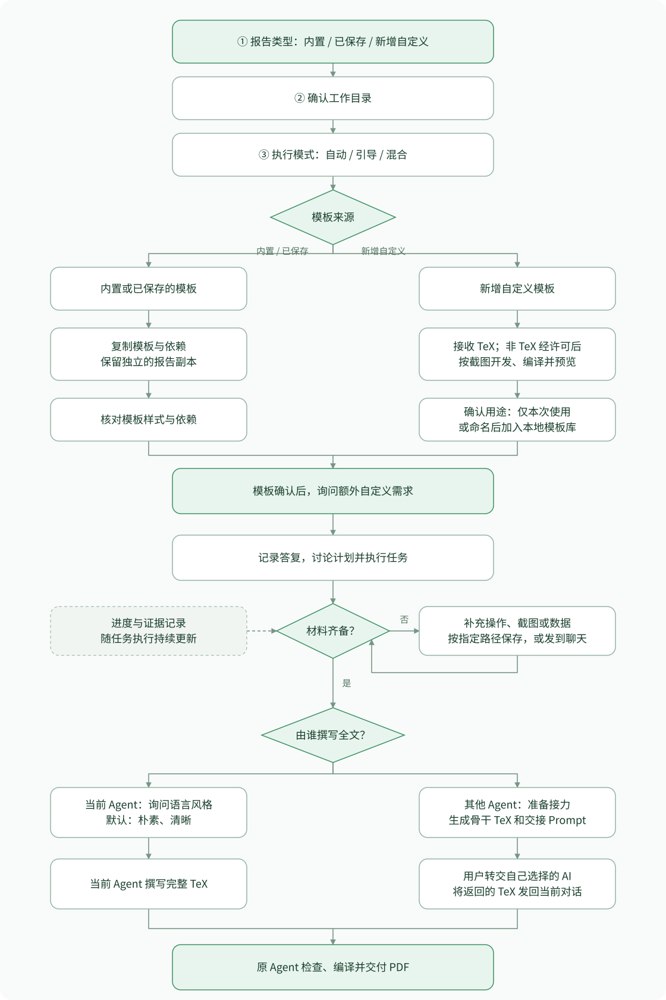

# report-template

把老师的要求文档或截图交给 Agent，完成任务和材料准备，再生成报告 PDF 与可编辑的 TeX 源文件。

支持实验报告、文科报告、学术汇报和自定义报告。内置三套 TeX 模板，也能经你许可按样式截图制作新模板，逐步扩充本地模板库。写作可由当前 Agent 完成，或交给你选择的其他 AI 接力。

## 安装 Skill

采用 [Vercel Agent Skills](https://github.com/vercel-labs/agent-skills#installation) 使用的 [Skills CLI](https://github.com/vercel-labs/skills#install-a-skill) 安装方式，直接从 GitHub 获取，不依赖本地仓库位置。首次使用先按下节安装依赖，再在任意目录执行：

```sh
npx skills add Hanggoash/report-template --skill report-template --agent codex --global
```

`--global` 安装到用户级技能目录，供不同项目使用；`--agent codex` 指定 Codex。使用其他受支持的 Agent 时，可去掉该参数，按安装器提示选择。

当前仓库为私有仓库，安装账号须有访问权限，并已配置 GitHub 的 Git 认证；安装器会沿用现有凭据。安装后可检查：

```sh
npx skills list --global --agent codex
```

如技能未出现，重新加载技能或新建会话。重装或更新前，请先备份自己添加的 `assets/templates/custom/` 模板库。

## 安装依赖

| 依赖 | 用途 |
| --- | --- |
| Node.js 22.20.0 以上（推荐当前 LTS）及 npm/npx | 运行 Skills CLI；版本要求见[安装器配置](https://github.com/vercel-labs/skills/blob/main/package.json)。 |
| Git | 获取技能仓库，包括私有仓库。 |
| Python 3.9 以上 | 运行目录创建和资源检查工具，无需额外 Python 包。 |
| XeLaTeX、中文支持和 LaTeX 宏包 | 编译中文报告和 Beamer。 |
| latexmk | 自动完成多轮编译；Windows 还需 Perl。 |

已有相应工具时可跳过安装。以下命令安装本地编译环境；完整 TeX 发行版占用空间较大，请预留数 GB。随 Skill 提供的字体无需另行安装到系统，保持其项目内相对路径即可。

<details>
<summary>macOS：Homebrew + MacTeX</summary>

未安装 Homebrew 时，先运行[官方安装命令](https://docs.brew.sh/Installation)，并按安装器提示设置 PATH：

```sh
/bin/bash -c "$(curl -fsSL https://raw.githubusercontent.com/Homebrew/install/HEAD/install.sh)"
```

然后安装工具和不带图形应用的完整 [MacTeX](https://formulae.brew.sh/cask/mactex-no-gui)：

```sh
brew install node git python
brew install --cask mactex-no-gui
```

安装后重新打开终端。若仍找不到 TeX 命令，可在当前终端执行：

```sh
export PATH="/Library/TeX/texbin:$PATH"
```

MacTeX 包含 XeLaTeX、中文字体和宏包、latexmk；可使用 macOS 自带的 Perl。

</details>

<details>
<summary>Windows 10/11（x64）：WinGet + MiKTeX</summary>

在 PowerShell 中运行以下命令；`winget` 由微软的[应用安装程序](https://learn.microsoft.com/en-us/windows/package-manager/winget/)提供：

```powershell
winget install --id OpenJS.NodeJS.LTS --exact --source winget
winget install --id Git.Git --exact --source winget
winget install --id Python.Python.3.13 --exact --source winget
winget install --id MiKTeX.MiKTeX --exact --scope user --source winget
winget install --id StrawberryPerl.StrawberryPerl --exact --source winget
```

使用用户级 MiKTeX 安装。Strawberry Perl 用于运行 [latexmk](https://ctan.org/pkg/latexmk)。安装后重新打开 PowerShell，再安装中文支持与编译工具，并允许 MiKTeX 在编译时下载其他缺失宏包：

```powershell
miktex packages update-package-database
miktex packages install ctex fandol latexmk
initexmf --set-config-value='[MPM]AutoInstall=yes'
```

命令依据 MiKTeX 的[包管理说明](https://docs.miktex.org/manual/miktex-packages.html)和[自动安装说明](https://miktex.org/kb/just-enough-tex)。首次编译需联网下载尚未安装的宏包。

若 PowerShell 提示禁止运行 `npx.ps1`，可将安装命令中的 `npx` 换成 `npx.cmd`。

</details>

<details>
<summary>Linux：Ubuntu / Debian（Bash）</summary>

安装 Git、Python 和 TeX Live。以下组件覆盖三套内置模板所需的 XeLaTeX、[中文支持](https://packages.ubuntu.com/noble/texlive-lang-chinese)及[常用宏包](https://packages.ubuntu.com/noble/texlive-latex-extra)：

```sh
sudo apt update
sudo apt install -y git curl ca-certificates python3 \
  texlive-xetex texlive-lang-chinese texlive-latex-extra \
  texlive-fonts-recommended texlive-pictures latexmk
```

系统源中的 Node.js 可能低于 Skills CLI 的要求，可用 [nvm 官方安装方式](https://github.com/nvm-sh/nvm#install--update-script)安装当前 LTS：

```sh
export NVM_DIR="$HOME/.nvm"
mkdir -p "$NVM_DIR"
curl -o- https://raw.githubusercontent.com/nvm-sh/nvm/v0.40.8/install.sh | bash
. "$NVM_DIR/nvm.sh"
nvm install --lts
```

其他 Linux 发行版请使用其包管理器安装对应组件；WSL 可在 Ubuntu 环境中执行同组命令。

</details>

### 检查与编译

依赖须安装在 Agent 实际执行任务的环境中；远程主机或 WSL 使用各自的环境。安装后重新打开终端和 Agent 应用，再检查：

```sh
node --version
npm --version
git --version
xelatex --version
latexmk -v
kpsewhich ctex.sty
kpsewhich FandolSong-Regular.otf
```

Python 在 macOS/Linux 用 `python3 --version` 检查，Windows 用 `py -3 --version`；Windows 另可运行 `perl --version`。两个 `kpsewhich` 命令应返回实际文件路径。

在作业的 `report/` 目录中编译：

```sh
latexmk -xelatex -interaction=nonstopmode -halt-on-error main.tex
```

文科模板把 `main.tex` 换成 `report.tex`；自定义模板使用其主文件名。仅使用 XeLaTeX 时连续编译两次。自定义模板若引入额外宏包或字体，再按其要求补充。

## 使用

安装后，可以输入 `$report-template`，也可以直接用自然语言调用：

```text
请你使用 report-template 的 skill，帮我完成这次实验报告。
用 report-template 继续上次的报告，工作目录是……
```

附上老师的要求或已有材料后，Agent 会依次询问：

1. **报告类型**：实验报告、文科报告、学术汇报、已保存的自定义类型，或新增自定义模板。
2. **工作目录**：本次任务的文件保存在哪里。
3. **执行模式**：自动执行、手动引导或混合协作。

| 模式 | 分工 |
| --- | --- |
| `automatic` 自动执行 | Agent 执行核心任务并验证，你提供材料和审阅成果。 |
| `guided` 手动引导 | 你亲自操作，Agent 分步指导、核对结果并排错。 |
| `hybrid` 混合协作 | 双方分工，例如 Agent 写代码，你在学校环境运行和截图。 |

模板确认后，Agent 会再询问你是否有额外的自定义需求，记录答复后讨论计划并执行。需要手动操作时，Agent 会告诉你在哪里截图、截图应包含什么；你可以按指定路径保存，也可以直接发到聊天中。

材料齐备后，Agent 会询问：**由当前 Agent 写全文，还是交给其他 Agent 接力？**

- **当前 Agent 写**：再选择语言风格，默认“朴素、清晰”，然后生成全文。
- **其他 Agent 接力**：当前 Agent 提供骨干 TeX 和交接 Prompt。你将它们及所需材料交给自己选择的 AI，再把得到的 TeX 代码发回当前对话。

最后都由当前 Agent 检查、编译，交付 PDF。

## 添加自己的模板

有 TeX 模板可以直接提供；只有 Word、PDF 或想要的样式时，先提供样式截图。Agent 会在你确认的工作目录中保存原始材料，**取得你的许可后**开发 TeX 模板，再用编译预览与你核对效果。

样式确认后，你可以选择：

- **仅本次使用**：模板留在本次工作目录，不加入 Skill。
- **永久保存到本地 Skill**：为模板命名并指定所属类型。Agent 会去除本次报告的个人信息和实际内容，保存为可复用模板；下次启动时，它会出现在报告类型选项中。

保存到本地模板库不会自动上传 GitHub。模板会随你的选择积累，无需每次重新提供样式。

## 流程示意



## 文件保存

所有文件保存在你确认的工作目录中：

- `templates/custom/`：本次自定义模板的原件、样式截图和依赖（如使用）。
- `report/`：报告 TeX、字体和正文图片。
- `materials/`、`evidence/`、`work/`：原始材料、截图数据和代码。
- `handoff/`：接力写作所用的骨干源码和 Prompt（如选择接力）。
- `deliverables/`：最终 PDF 和源文件包。

Agent 会保存进度记录。下次输入“`$report-template` 继续某项任务”，并说明工作目录即可。

永久保存的模板位于本地 Skill 的 `assets/templates/custom/`，每个模板包含独立目录和名称记录，供以后新建报告时选择。

## 资源说明

思源黑体的许可见其 `fonts/LICENSE.txt`；其他字体、校徽和手册沿用各自授权，本仓库未统一授予再分发许可。自定义模板也需提供编译所需的字体和图片。

Agent 的执行指令见 [SKILL.md](SKILL.md)。
