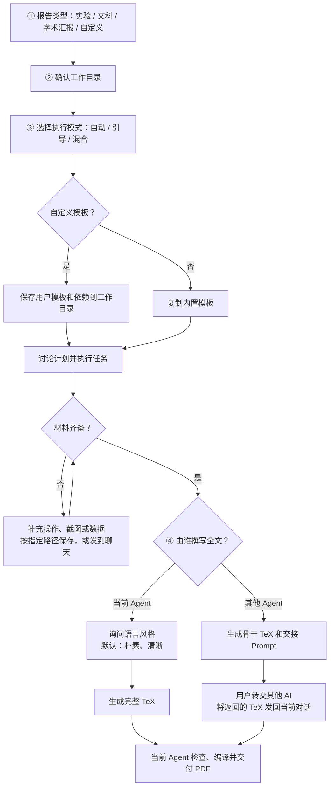

# report-template

把老师的要求文档或截图交给 Agent，完成任务和材料准备，再生成报告 PDF 与可编辑的 TeX 源文件。

支持实验报告、文科报告、学术汇报，以及使用自定义模板的其他报告。内置三套 TeX 模板及对应字体、图片和手册；写作时可由当前 Agent 完成，也可交给你选择的其他 AI 接力。

## 安装

若仓库位于桌面的 `Develop/report-template`，可在 Codex 中通过符号链接安装：

```sh
mkdir -p ~/.codex/skills
ln -s ~/Desktop/Develop/report-template ~/.codex/skills/report-template
```

目标位置已有同名技能时先检查。如安装后未识别，重新加载技能或新建会话。

辅助工具需要 Python 3；生成 PDF 需要支持中文的 XeLaTeX 环境，例如 TeX Live / MacTeX，或支持完整项目的在线编译器。

## 使用

输入 `$report-template`，附上老师的要求或已有材料。Agent 会依次询问：

1. **报告类型**：实验报告、文科报告、学术汇报或自定义模板。
2. **工作目录**：本次任务的文件保存在哪里。
3. **执行模式**：自动执行、手动引导或混合协作。

| 模式 | 分工 |
| --- | --- |
| `automatic` 自动执行 | Agent 执行核心任务并验证，你提供材料和审阅成果。 |
| `guided` 手动引导 | 你亲自操作，Agent 分步指导、核对结果并排错。 |
| `hybrid` 混合协作 | 双方分工，例如 Agent 写代码，你在学校环境运行和截图。 |

随后讨论计划并执行。需要手动操作时，Agent 会告诉你在哪里截图、截图应包含什么；你可以按指定路径保存，也可以直接发到聊天中。

材料齐备后，Agent 会问第 **4** 个问题：**由当前 Agent 写全文，还是交给其他 Agent 接力？**

- **当前 Agent 写**：再选择语言风格，默认“朴素、清晰”，然后生成全文。
- **其他 Agent 接力**：当前 Agent 提供骨干 TeX 和交接 Prompt。你将它们及所需材料交给自己选择的 AI，再把得到的 TeX 代码发回当前对话。

最后都由当前 Agent 检查、编译，交付 PDF。

## 流程示意



## 文件保存

所有文件保存在你确认的工作目录中：

- `templates/custom/`：自定义模板原件及依赖（如使用）。
- `report/`：报告 TeX、字体和正文图片。
- `materials/`、`evidence/`、`work/`：原始材料、截图数据和代码。
- `handoff/`：接力写作所用的骨干源码和 Prompt（如选择接力）。
- `deliverables/`：最终 PDF 和源文件包。

Agent 会保存进度记录。下次输入“`$report-template` 继续某项任务”，并说明工作目录即可。

## 资源说明

思源黑体的许可见其 `fonts/LICENSE.txt`；其他字体、校徽和手册沿用各自授权，本仓库未统一授予再分发许可。自定义模板也需提供编译所需的字体和图片。

Agent 的执行指令见 [SKILL.md](SKILL.md)。
